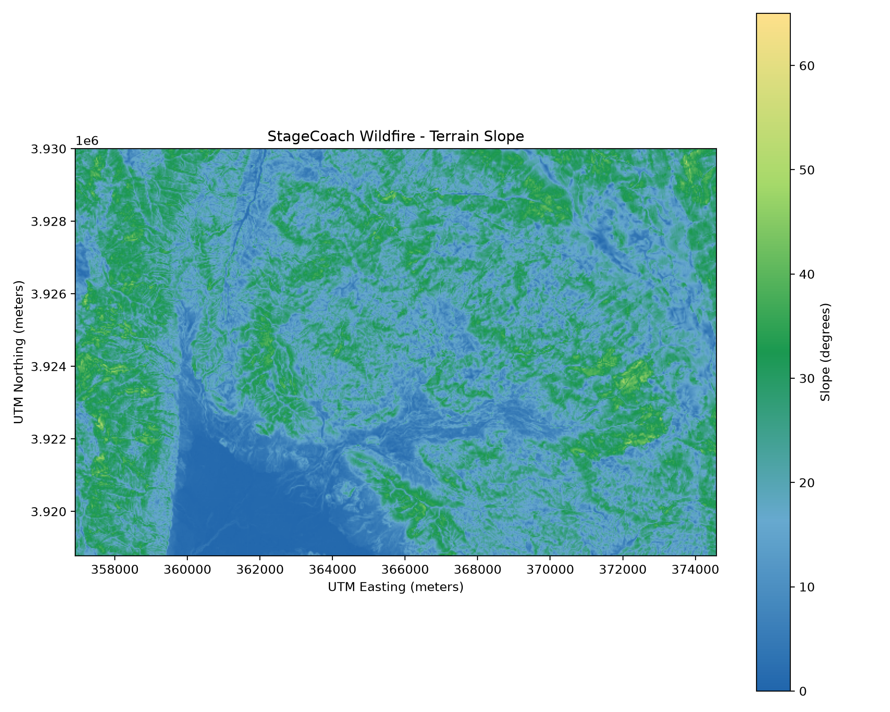
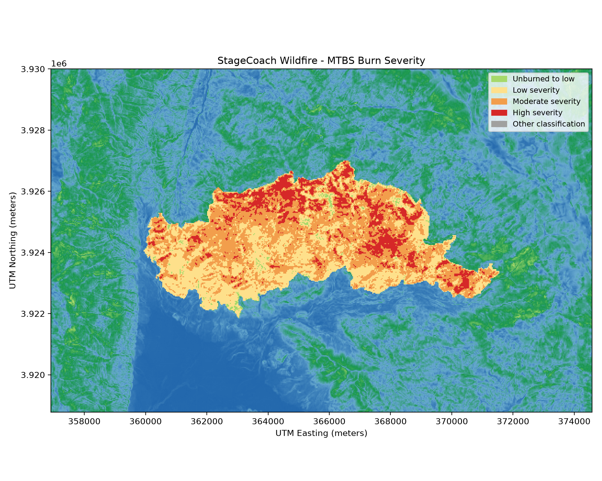
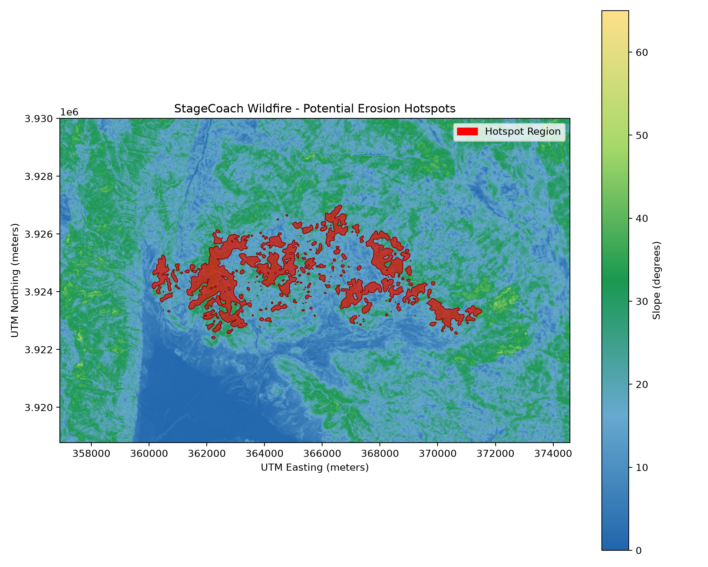

# Post Fire Hazard Hotspot Screening System

**Senior Design Project | Python, GIS, Remote Sensing**

A Python-based geographic information system (GIS) pipeline for screening potential post fire hazard hotspots. The system combines **Monitoring Trends in Burn Severity (MTBS)** burn-severity classifications with **USGS elevation data** to identify locations where high burn severity and steep terrain overlap.

> **Project status:** The reusable GIS analysis pipeline is implemented and has processed six wildfire datasets. Database storage, a graphical user interface (GUI), and full application integration are planned next. 

## Project objectives

- Process MTBS wildfire rasters and USGS digital elevation models (DEMs).
- Derive terrain slope and align it with the wildfire raster grid.
- Identify potential hotspots using consistent, documented classification rules.
- Generate georeferenced output rasters, maps, and summary statistics.
- Extend the working pipeline into an application with persistent records and a user interface.

## Current capabilities

- Numbered menu to select an available wildfire dataset.
- Automatic use of the single DEM in the `Elevation/` directory.
- User-entered wildfire name for readable map titles.
- Input validation for coordinate systems and geographic overlap.
- DEM reprojection to a 10 m analysis grid and terrain slope calculation.
- Alignment of slope to the MTBS raster grid.
- Potential hotspot classification, connected-region counts, and acreage statistics.
- Three PNG maps for each analysis: terrain slope, MTBS burn severity, and potential erosion hotspots.
- Separate output folders identified by the original MTBS dataset filename.

## Methodology

1. **Select inputs.** Choose an MTBS six-class burn-severity (`*dnbr6.tif`) raster. The current command-line workflow uses the single DEM available in `Elevation/`.
2. **Validate coverage.** Check raster coordinate systems and geographic overlap.
3. **Prepare elevation.** Reproject the DEM onto a 10 m grid with a margin for neighborhood-based slope calculation.
4. **Calculate slope.** Apply a 3 × 3 Horn slope calculation and express slope in degrees.
5. **Align datasets.** Average the slope grid onto the MTBS raster grid, checking for missing slope values over valid wildfire pixels.
6. **Classify potential hotspots.** Mark pixels meeting **both** conditions:
   - MTBS burn-severity class **3 or 4**; and
   - terrain slope **at least 23°**.
7. **Summarize and visualize.** Calculate hotspot acreage, percent coverage, slope statistics. Save raster outputs and PNG maps.

The smoothed hotspot overlay is **for map presentation only**. The underlying hotspot classification raster and statistics are calculated without that smoothing.

## Example analysis: Stagecoach Fire (2020)

The three maps below illustrate how the terrain and burn-severity inputs relate to the final hotspot screening output.

### Terrain slope



### MTBS burn severity



### Potential erosion hotspots



For Stagecoach, the pipeline identified **7,362 hotspot pixels**, covering approximately **1,637.27 acres**, or **21.24%** of the analyzed area.

## Six wildfire test results

| Wildfire | Analyzed area (acres) | Potential hotspot area (acres) | Hotspot coverage | Hotspot clusters |
|---|---:|---:|---:|---:|
| Garden (2017) | 1,484.49 | 66.27 | 4.46% | 14 |
| Caldwell (2017) | 1,519.85 | 174.36 | 11.47% | 55 |
| French (2021) | 27,322.99 | 6,282.21 | 22.99% | 1,240 |
| Highway (2017) | 1,692.65 | 12.45 | 0.74% | 13 |
| Peak (2021) | 2,315.35 | 271.77 | 11.74% | 130 |
| Stagecoach (2020) | 7,709.09 | 1,637.27 | 21.24% | 485 |

All six datasets completed processing through the reusable pipeline. For the Garden dataset, the refactored hotspot and aligned slope rasters were also compared against the earlier pipeline outputs and matched pixel for pixel. These checks demonstrate computational consistency and successful execution.

## Repository layout

```text
.
├── .gitignore
├── README.md
├── requirements.txt
├── docs/
│   └── images/
│       ├── stagecoach_slope.png
│       ├── stagecoach_burn_severity.png
│       └── stagecoach_hotspots.png
├── Elevation/             # Local USGS DEM 
├── Wildfires/             # Six local MTBS datasets 
├── Results/
│   ├── RawResults/        # Original Garden analysis outputs 
│   └── RefactorTest/      # Reusable pipeline outputs 
└── src/
    ├── pipeline.py       # Earlier incremental development pipeline
    └── pipeline_select.py # Reusable command line pipeline
```

The `Elevation/`, `Wildfires/`, and `Results/` directories are excluded from Git because the source datasets and generated rasters can be large. Only selected example PNG maps are committed under `docs/images/`.

## Setup and usage

### Requirements

- Python 3 with the packages listed in `requirements.txt`.
- MTBS six class burn severity raster files (`*dnbr6.tif`) organized under `Wildfires/`.
- One compatible USGS DEM GeoTIFF under `Elevation/` that covers the selected wildfire.

Install the Python packages from the repository root:

```bash
python -m pip install -r requirements.txt
```

Run the reusable pipeline:

```bash
python src/pipeline_select.py
```

Select a wildfire from the numbered list and enter its display name when prompted. Results are written to `Results/RefactorTest/<MTBS_dataset_stem>/`, including:

- `elevation_10m.tif`
- `slope_10m.tif`
- `slope_30m.tif`
- `hotspots.tif`
- `slope_map.png`
- `burn_severity_map.png`
- `hotspot_map_smooth.png`


## Development roadmap

| Phase | Work | Status / target |
|---|---|---|
| 1. GIS pipeline | Input handling, terrain processing, hotspot classification, maps, and statistics | Completed |
| 2. Multi-fire testing | Run six MTBS datasets and check computational consistency | Completed |
| 3. Database design | Review ERD and finalize MySQL schema | Next |
| 4. Database implementation | Create tables and store wildfire, analysis, and output-file records | Planned: November 9–15, 2026 |
| 5. GUI | Select a wildfire, run analysis, and view maps/statistics | Planned: November 9–15, 2026 |
| 6. Integration and testing | Connect GUI, pipeline, and MySQL; test persistence and retrieval | Planned: November 16–22, 2026 |


## Limitations and future work

- The current rule combines burn severity and slope. Other variables may be added to expand targeted features. 
- The current input workflow assumes one DEM covers the selected wildfire.
- Independent validation against observed erosion and additional environmental factors are possible future extensions.
- The GUI and MySQL integration are not yet implemented.

## Data sources

- [Monitoring Trends in Burn Severity (MTBS)](https://www.mtbs.gov/) — wildfire burn-severity data.
- [U.S. Geological Survey (USGS)](https://www.usgs.gov/) — elevation data.

Source datasets are not redistributed in this repository. Users must obtain suitable data from the original providers.
